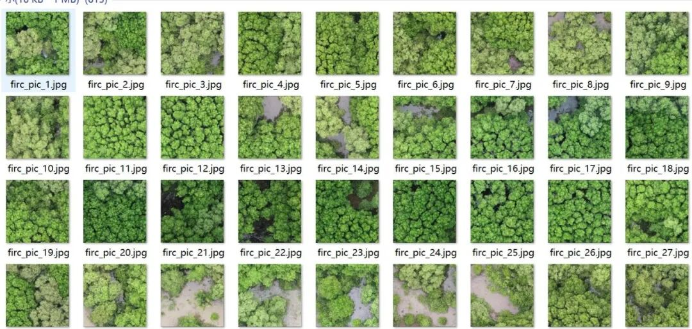
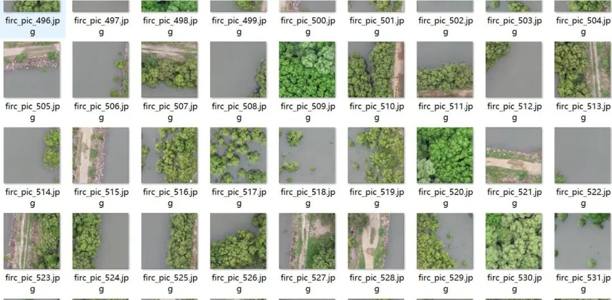
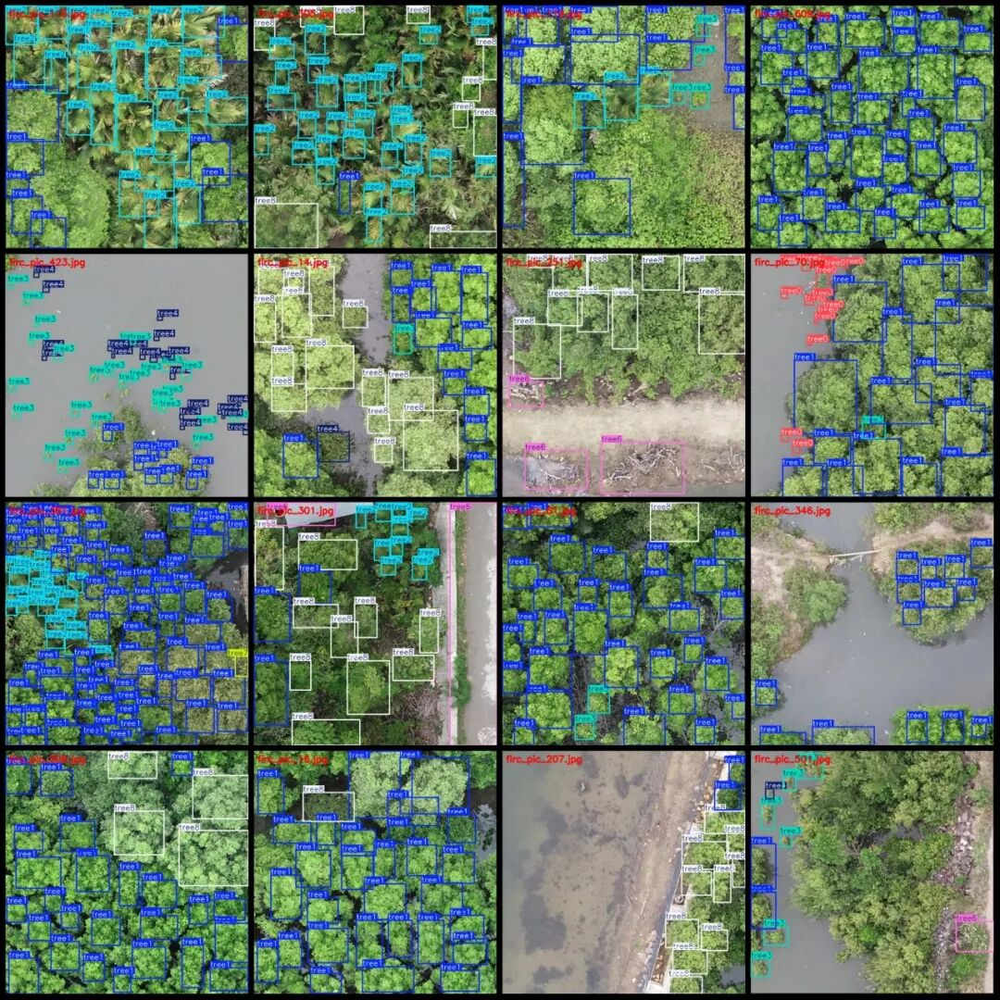
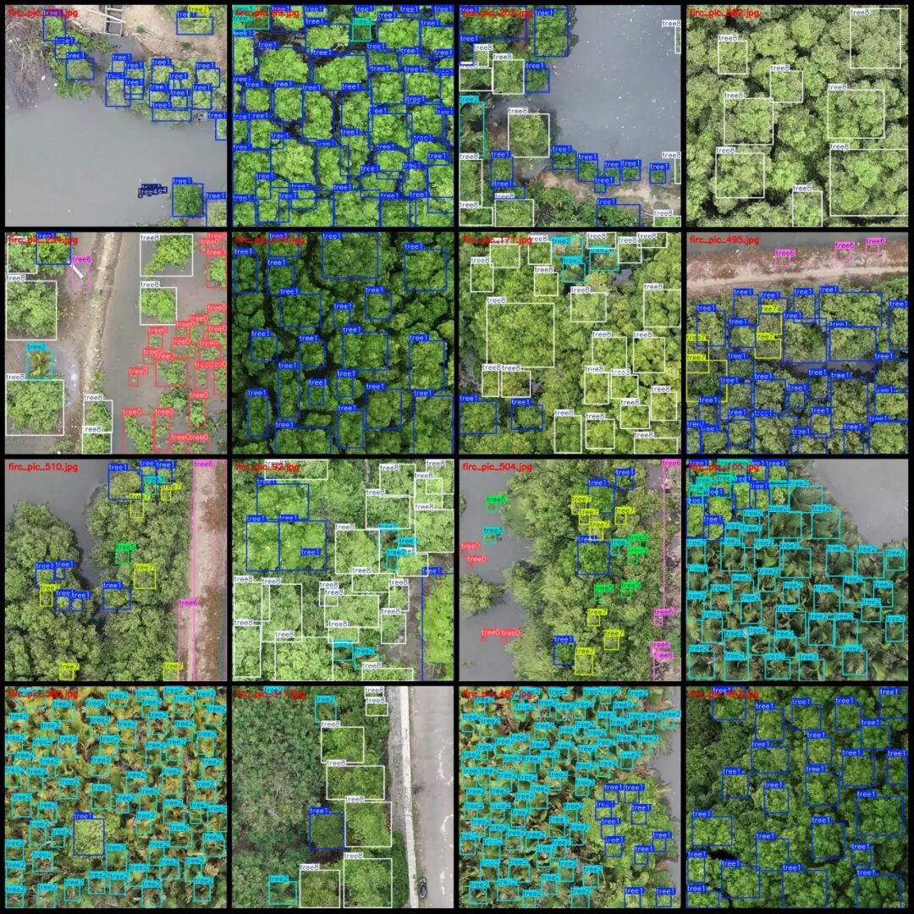

# Wetland mangrove target detection dataset VOC+YOLO format with 613 images in 9 categories

Dataset format: Pascal VOC format + YOLO format (txt file without split path, only containing jpg images and corresponding VOC format xml files and yolo format txt files)

Number of images (number of jpg files): 613

Number of annotations (number of xml files): 613

Number of annotations (number of txt files): 613

Label category count: 9

Label category names (Note that the order of categories in the YOLO format does not correspond to this, but is based on the classes.txt file in the labels folder): ["tree0", "tree1", "tree2", "tree3", "tree4", "tree5", "tree6", "tree7", "tree8"]

Number of boxes labeled in each category:

tree0 frame count = 466

tree1 box count = 8895

tree2 box count = 2649

tree3 frame count = 1302

tree4 Frames = 1522

tree5 Frames = 36

tree6 frame count = 740

tree7 Frames = 298

tree8 frame count = 2925

Total frame count: 18833

Number of images per category:

tree0 occupies = 68

tree1 occupies the number of images = 553

tree2 has 182 images.

tree3 has 258 images.

tree4 occupies = 149

tree5 occupies the number of images = 26

tree6 has 191 images.

tree7 occupies the number of images = 68

tree8 occupies the number of images = 263

Image resolution: 640x640

Using labelImg:

Annotation rules: Draw a rectangle around the category.

Important Notice: The dataset does not have separate training, validation, and test sets; you need to partition them yourself.

Special : This dataset does not guarantee the accuracy of the trained models or weight files.

Image Preview:

Annotation example:

## Payment

Here is a pay link on Stripe ( https://buy.stripe.com/3cs8yP7sY87d0vu9AB ). Please contact me lonlonago@foxmail.com after funding $89, and I will send you a complete data files , thank you!

